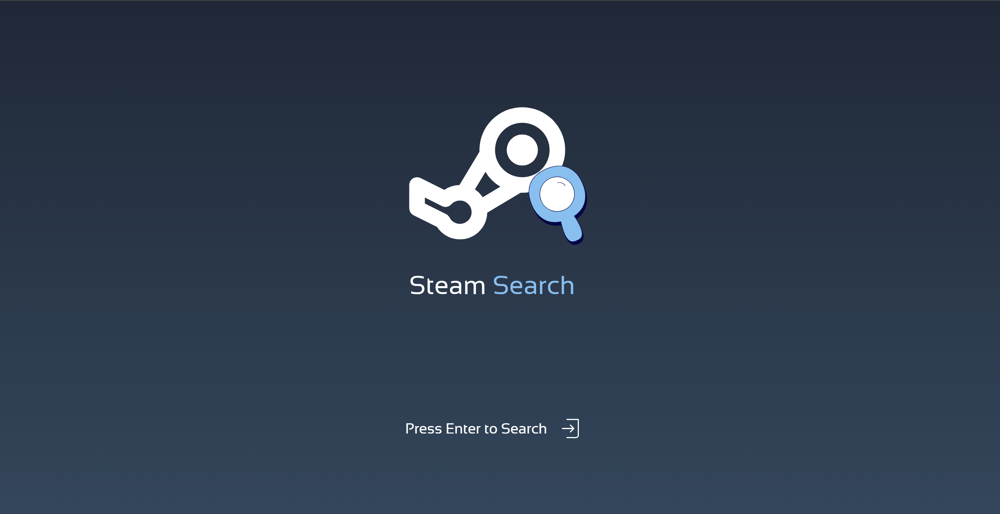
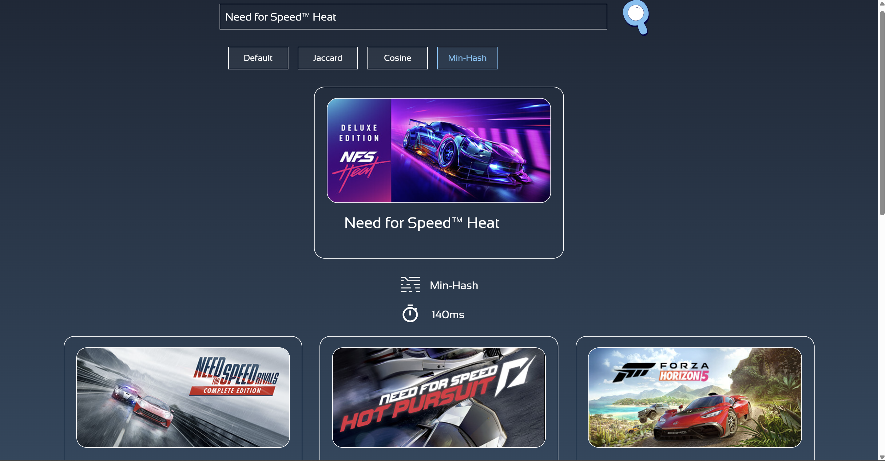

<p align="center">
  
</p>

<p align="center">
  
  
  
  
  
  
  
</p>

## What it is

Steam Search is a game recommendation engine with access to over 100,000 games from Steam.
Type in a game you like, and it finds similar ones in under 200ms.

Game data is indexed into compact binary files, shrinking a 600MB JSON dataset down to
~125MB and cutting hosting RAM usage from ~1GB to ~300MB. The recommendation algorithms
are implemented in C++ for that sub-200ms response time.

**Live demo:** https://steamsearch-production-622f.up.railway.app/

## Demo

<p align="center">
  <a href="https://steamsearch-production-622f.up.railway.app/">
    
  </a>
</p>

## Tech Stack

| Layer | Tech |
|---|---|
| Frontend | React, Vite, CSS, JavaScript |
| Backend | C++20, [Crow](https://crowcpp.org/) (web framework), [Asio](https://think-async.com/Asio/) (networking), [nlohmann/json](https://github.com/nlohmann/json) |
| Build | CMake 3.22+ |
| Deploy | Docker, Railway |

The backend's C++ dependencies (Crow, Asio, nlohmann/json) are fetched automatically by CMake the first time you build — no package manager (vcpkg, apt, etc.) setup required.

## What you need

| Tool | Why | Link |
|---|---|---|
| Git | Lets CMake fetch Crow/Asio automatically | https://git-scm.com/downloads |
| CMake 3.22+ | Builds the C++ backend | https://cmake.org/download/ |
| A C++20 compiler | Compiles the backend | [CLion](https://www.jetbrains.com/clion/) bundles one (MinGW), or install [MinGW-w64](https://www.mingw-w64.org/)/MSVC yourself |
| Node.js (npm) | Runs the frontend | https://nodejs.org/ |

If you already have CMake or a compiler installed system-wide, `setup.bat` uses those. If not, and you have CLion installed, it falls back to CLion's bundled copies automatically.

## Getting started

**1. Install the prerequisites above** if you don't already have them.

**2. Run setup.** On Windows, double-click **`setup.bat`** — it checks for the required tools, builds the backend, and installs frontend dependencies. First run takes a few minutes (it downloads Crow/Asio and compiles the server).

**3. Start it.** Double-click **`start.bat`** — it starts the backend, starts the frontend dev server, and opens the site in your browser.

That's it. Re-run `start.bat` any time to relaunch; only re-run `setup.bat` if you've wiped `node_modules` or the `cmake-build-debug` folder.

### Manual setup (any OS)

If you're not on Windows, or just want to run the steps yourself:

**Backend:**
```bash
cmake -S . -B cmake-build-debug
cmake --build cmake-build-debug --target steam_server
./steam_server          # macOS/Linux
.\steam_server.exe      # Windows
```
The server listens on port `8080` by default (override with the `PORT` env var), and expects `data/` (already included in this repo) relative to its working directory.

**Frontend:**
```bash
cd frontend
npm install
npm run dev
```
By default it points at `http://localhost:8080` for the API; override with a `VITE_API_URL` env var.

### Running via Docker

The backend can also be built and run exactly as it's deployed on Railway:
```bash
docker build -t steamsearch .
docker run -p 8080:8080 steamsearch
```

## Where things live

| Folder | What is in it |
|---|---|
| `src/` | The C++ backend — HTTP server, game store, and recommendation logic |
| `frontend/` | The React + Vite frontend |
| `data/` | The pre-indexed binary game catalog the server loads on startup |
| `Legacy/` | Earlier implementation, kept for reference |
| `screenshots/` | Images used in this README |
| `CMakeLists.txt` | Backend build config, including the FetchContent dependency setup |
| `Dockerfile` | Container build used for local Docker runs and Railway deploys |
| `setup.bat` / `start.bat` | One-click Windows build and launch scripts |

### Developed by Kushagra Katiyar
